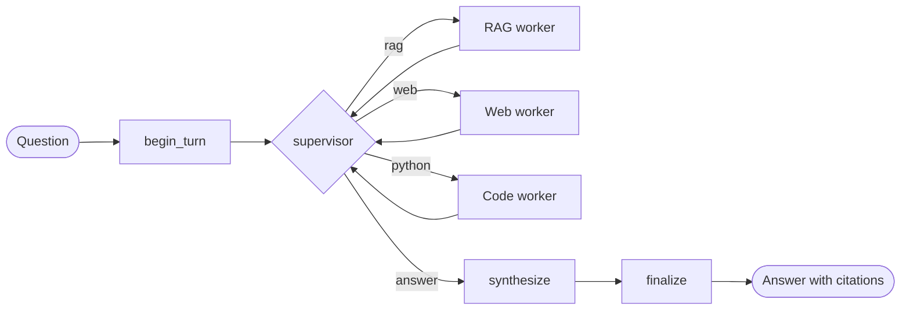

# Local-First Multi-Agent RAG Platform

A local-first, multi-agent question-answering platform. A **LangGraph supervisor** decides whether a
question needs your documents, the web, or a calculation, sends it to the right **worker**, and
writes a cited answer. The language model runs on your own machine through Ollama, documents live
in Qdrant, and every step is traced in Arize Phoenix. No paid cloud API is involved.

- **Three workers:** document search (RAG), web search, and sandboxed Python execution.
- **Hybrid retrieval:** dense and BM25-style sparse vectors fused in Qdrant, then re-ranked by a cross-encoder.
- **Cited, grounded answers** that refuse to guess when the documents do not contain the answer.
- **Three ways to use it:** a chat page, a terminal chat, and an HTTP API with streaming.
- **Measured, not assumed:** a deterministic evaluation suite for retrieval, routing and answers.
- **Local by default:** the only feature that sends anything off your machine is web search, and it can be switched off.

> Built for a CPU-only laptop (16 GB RAM) running `llama3.1:8b`. Expect roughly 8 tokens per second,
> so a simple warm question takes about 6 s and a multi-step one roughly 15 to 30 s (estimate). See [Performance](#performance).

## Contents

1. [How it works](#how-it-works)
2. [Quick start](#quick-start)
3. [Using it](#using-it)
4. [Configuration](#configuration)
5. [Components in detail](#components-in-detail)
6. [Observability](#observability)
7. [Evaluation](#evaluation)
8. [Security](#security)
9. [Development](#development)
10. [Design decisions](#design-decisions)
11. [Performance](#performance)
12. [Troubleshooting](#troubleshooting)
13. [Known limits](#known-limits)

## How it works



1. **`begin_turn`** resets the per-turn state. The conversation history is kept (memory per thread id).
2. **`supervisor`** picks the next step. A deterministic policy runs first (answer now if the last
   result was confident, stop after a repeated query, stop at the step limit). The language model is
   asked only when the policy has no answer, and its reply is constrained to a JSON schema whose
   `next` field is an enum of the registered workers plus `answer`.
3. **Workers** run and report an *observation* (passages, a confidence flag, a summary). Every
   worker returns to the supervisor, so the graph is a bounded cycle, not a pipeline.
4. **`synthesize`** writes the answer from the collected passages with numbered citations. With no
   passages it says so; with no workers used it answers directly.
5. **`finalize`** appends the exchange to the thread's history.

| Worker | What it does | Leaves your machine? |
| --- | --- | --- |
| `rag` | Hybrid search over your ingested documents, cross-encoder re-ranking, relevance floor | No |
| `web` | DuckDuckGo search; uses result titles and snippets only | **Yes**: the query text |
| `python` | The model writes a short script; a locked-down Docker container runs it | No |

A worker whose dependency is unavailable (no Docker, search disabled) is simply not registered, so
the supervisor cannot route to it.

## Quick start

### Prerequisites

- Python 3.10 or newer
- [Ollama](https://ollama.com) running on the host
- Docker Desktop (Qdrant, Phoenix, and the code sandbox)

```powershell
ollama pull llama3.1:8b
ollama pull nomic-embed-text
```

Set these **Ollama** environment variables, then quit and restart Ollama (Windows: System
Properties, Environment Variables). They stop the embedding model from evicting the chat model and
keep the chat model loaded between questions:

```
OLLAMA_MAX_LOADED_MODELS=2
OLLAMA_KEEP_ALIVE=30m
```

### Install and start

```powershell
python -m venv .venv
.venv\Scripts\activate                 # macOS/Linux: source .venv/bin/activate
pip install -r requirements-dev.txt
pip install -e . --no-deps
copy .env.example .env                 # macOS/Linux: cp .env.example .env

docker compose up -d qdrant phoenix    # vector database and tracing UI
docker pull python:3.12-slim           # once: image for the code sandbox

python scripts/smoke_test.py           # checks Ollama, the models and Qdrant
python scripts/ingest.py samples       # load the sample documents
python scripts/serve.py                # chat page at http://127.0.0.1:8000/
```

Prefer the terminal? Run `python scripts/chat.py` instead of `serve.py`.

macOS and Linux users can use the `make` targets listed under [Development](#development).

## Using it

### Chat page

Open **http://127.0.0.1:8000/** after `python scripts/serve.py`.

- The answer streams as it is written, with a status line showing which tool the agent used.
- `[1]` markers in an answer are clickable: they jump to the source passage. Sources are listed under each answer.
- **Stop** cancels the turn on the server. **New chat** forgets the conversation.
- The paperclip uploads files into the knowledge base.
- The top bar shows whether Ollama, the model and Qdrant are reachable.
- If `API_KEY` is set the page asks for it once per browser tab.

The page is plain HTML, CSS and JavaScript in `src/agentic_rag/api/static/`: no build step, no
external requests, and a strict Content-Security-Policy. The palette is defined at the top of `chat.css`.

### Terminal chat

```powershell
python scripts/chat.py                              # multi-turn conversation
python scripts/chat.py --once "what is keep_alive?" --trace
```

Commands inside the chat: `/trace` toggles the per-step trace, `/new` starts a fresh conversation,
`/exit` quits. On first start it downloads the FlashRank model (about 22 MB) into
`data/models/flashrank`; if that fails it warns and continues without re-ranking.

### Adding your own documents

```powershell
python scripts/ingest.py C:\path\to\your\docs       # PDFs, Markdown, text, source code
python scripts/ingest.py docs --force               # re-ingest even unchanged files
python scripts/ingest.py docs --reset               # drop and recreate the collection first
```

Ingestion is idempotent: unchanged files are skipped by SHA-256, and one bad file never aborts a
batch. Scanned PDFs without a text layer are rejected with a clear message (no OCR). You can also
upload files from the chat page or `POST /v1/documents`.

Inspect retrieval directly, without the agent:

```powershell
python scripts/query.py "error E-4021" --mode compare     # dense vs sparse vs hybrid side by side
python scripts/query.py "chunk overlap" -k 3 --source samples/rag_basics.md
```

### HTTP API

Interactive documentation is at **http://127.0.0.1:8000/docs**.

| Endpoint | Purpose |
| --- | --- |
| `GET /health` | Liveness; needs nothing |
| `GET /ready` | Ollama, the model and Qdrant are reachable (503 if not) |
| `POST /v1/ask` | One turn, JSON reply |
| `POST /v1/ask/stream` | One turn as Server-Sent Events |
| `POST /v1/documents` | Upload files to ingest (multipart field `files`) |
| `GET /v1/documents` | List ingested sources with chunk counts |
| `DELETE /v1/sessions/{thread_id}` | Forget a conversation |

Request body for both ask endpoints: `{"question": "...", "thread_id": "optional"}`. Omit
`thread_id` to start a conversation; the reply returns the id to send next time. Add
`?include_trace=true` for the per-step trace.

```powershell
Invoke-RestMethod http://127.0.0.1:8000/ready

$body = @{ question = "What is the default keep alive?" } | ConvertTo-Json
Invoke-RestMethod http://127.0.0.1:8000/v1/ask -Method Post -Body $body -ContentType "application/json"

# streaming (use curl.exe in PowerShell: plain curl is an alias for Invoke-WebRequest)
$body | Set-Content q.json
curl.exe -N http://127.0.0.1:8000/v1/ask/stream -H "Content-Type: application/json" -d "@q.json"
curl.exe http://127.0.0.1:8000/v1/documents -F "files=@samples/rag_basics.md"
```

**Stream events** (`event:` name, then a JSON `data:` line): `start` (the thread id), `step` (a
supervisor or worker finished, with timing and details), `token` (a piece of the answer), then
`final` (the complete response with citations and metrics) or `error`. Comment lines (`: keep-alive`)
keep idle connections open.

| Status | Meaning |
| --- | --- |
| 401 | Missing or wrong `X-API-Key` (only when `API_KEY` is set) |
| 409 | A turn is already running on that `thread_id` |
| 413 / 415 | Upload too large / unsupported file type |
| 422 | Invalid request (empty question, bad thread id, unknown field) |
| 502 / 503 / 504 | Backend failure / Ollama unreachable / timeout |

Behaviour worth knowing: one turn runs at a time overall by default (`API_MAX_CONCURRENT_TURNS=1`;
a CPU-bound model gains nothing from parallelism), and a streaming client that disconnects cancels
its turn within about a second. A streamed answer is not retried if Ollama fails half-way, because
a retry would repeat text; the non-streaming call keeps its retries.

## Configuration

Everything is an environment variable, read from `.env` (copy `.env.example`, which documents every
setting). Common ones:

| Variable | Default | Purpose |
| --- | --- | --- |
| `OLLAMA_MODEL` | `llama3.1:8b` | Chat model |
| `OLLAMA_NUM_CTX` | `4096` | Context window |
| `OLLAMA_KEEP_ALIVE` | `30m` | How long the model stays loaded (sent on every request) |
| `EMBEDDING_MODEL` / `EMBEDDING_DIM` | `nomic-embed-text` / `768` | Changing the model means changing the dimension and re-ingesting with `--reset` |
| `QDRANT_COLLECTION` | `documents` | Collection used by chat and the API |
| `RERANKER` | `flashrank` | Or `none` to skip re-ranking |
| `RERANK_MIN_SCORE` | `0.25` | Below this the supervisor treats retrieval as weak |
| `RERANK_MIN_PASSAGE_SCORE` | `0.001` | Passages scoring below this are dropped before answering |
| `GRAPH_MAX_STEPS` | `4` | Hard cap on supervisor loops |
| `HISTORY_TURNS` | `4` | Sliding window of conversation memory |
| `CODE_WORKER_ENABLED` | `true` | Sandboxed Python worker |
| `WEB_SEARCH_ENABLED` | `true` | Web worker; **the query leaves your machine** |
| `TRACING_ENABLED` | `false` | Send traces to Phoenix |
| `TRACING_CAPTURE_CONTENT` | `true` | `false` records timings and counts but not prompt text |
| `API_HOST` / `API_PORT` | `127.0.0.1` / `8000` | Where the API listens |
| `API_KEY` | empty | If set, `/v1` calls need an `X-API-Key` header; required to bind off-loopback |
| `API_MAX_UPLOAD_MB` | `20` | Per-file upload limit |
| `API_TURN_TIMEOUT_S` | `300` | Wall-clock limit per turn |

Settings are validated at start-up. For example, `ANSWER_CONTEXT_TOKENS + ANSWER_MAX_TOKENS + 1200`
must fit in `OLLAMA_NUM_CTX`, because Ollama silently drops the start of an over-long prompt, which
would remove the instructions.

## Components in detail

### Ingestion

Files are discovered, parsed into sections, chunked, embedded, and upserted.

- **Parsing:** PDFs per page, Markdown by heading (the heading path is stored), source code at top-level definitions, plain text by paragraph. Fenced code blocks stay whole.
- **Chunking** is structure-aware with overlap; sizes are estimated from characters (about 3.5 per token), not a tokenizer.
- **Each chunk is embedded with a location header** (file, heading path, page) so terse chunks still match a question. The stored and displayed text is the raw chunk.
- **Idempotent:** chunk ids derive from the source, file hash and index. A changed file's old chunks are deleted only after its new embeddings succeed.

### Retrieval

1. The query is embedded (dense) and encoded (sparse) and both searches run inside Qdrant.
2. **Reciprocal Rank Fusion** merges them. Dense search handles paraphrase; sparse search handles exact identifiers such as error codes and function names.
3. The top 20 candidates go to a **FlashRank cross-encoder** (`ms-marco-MiniLM-L-12-v2`), which re-orders them and supplies an absolute relevance score.
4. Passages under the relevance floor are dropped, and the rest are trimmed to the context budget.

The sparse vectors are a **deterministic hashed BM25**: term-frequency weights computed locally, with
Qdrant applying IDF at query time. There is no vocabulary file to keep in sync and nothing to download.

### Supervisor

Rules come before the model, because each routing call costs several seconds on CPU:

- A confident retrieval goes straight to the answer with no second routing call.
- A repeated (worker, query) pair forces an answer; `GRAPH_MAX_STEPS` bounds the loop.
- If retrieval finds nothing and no other worker is left to try, it answers instead of retrying.
- On a first question with no history and no pronoun-like references, the document worker searches the user's exact wording, because the model's rewrite can lose the very terms that match.
- If the model's rewritten query shares no content word with a self-contained question, the question is searched instead (a guard added after llama3.1 once replaced "capital of France" with the previous turn's query).
- If the routing call fails outright, it falls back to one document search and then answers.

### Answer generation

Passages are numbered and passed to the model with a prompt that requires inline citations, says
passages are untrusted data (not instructions), says source code and configuration count as facts,
and asks for clarification when passages are about different things that share a name. If the
passages do not contain the answer, the model is told to say so.

### Code worker and sandbox

The model writes a short script, a throwaway container runs it, and the output becomes a cited
passage. One repair attempt feeds the traceback back to the model. The image has only the standard
library, so data-science scripts fail.

```
docker run --rm --pull never -i --network none --read-only --tmpfs /tmp
  --cap-drop ALL --security-opt no-new-privileges --user 65534:65534
  --memory 256m --memory-swap 256m --cpus 1 --pids-limit 64  python -I -
```

Code goes in over stdin, so nothing is mounted. Output is capped while it is read, so a print loop
cannot fill host memory; on timeout the container is killed by name. `python scripts/check_tools.py`
proves the isolation (no network, read-only filesystem, memory limit, and so on) instead of assuming it.
This is container-level isolation with a shared kernel: fine for a local tool, not for hosting
strangers' code.

### Web worker

DuckDuckGo through the `ddgs` package, behind a `SearchProvider` interface. Only titles and snippets
are used; pages are not fetched. `ddgs` is an unofficial scraper and can be rate-limited; a
self-hosted SearXNG container would be the sturdier provider.

### Conversation memory

LangGraph state with a `MemorySaver` keyed by thread id. It lives in the server process, so it is
lost on restart, and only a sliding window is kept (no summarisation). State holds plain dicts
rather than Pydantic objects, because checkpointing Pydantic objects warns about unregistered types.

### Streaming

`AgentApp.ask_stream` runs the turn in its own task and feeds an event queue (`step`, `token`,
`final`, `error`). Only the final answer is streamed, via Ollama's `stream: true`; routing calls
are not, because they return JSON. Closing the stream cancels the task, and the cancellation reaches
the running worker even when the web server cancels the request with its own scoped cancellation
(a bug found and fixed with a live socket test).

## Observability

```powershell
docker compose up -d phoenix
# .env: TRACING_ENABLED=true
python scripts/chat.py            # then open http://localhost:6006, project "agentic-rag"
```

Every turn becomes a span tree: `agent.turn` with `supervisor`, `worker.*`, `retrieve`, `rerank`,
`ollama.chat`, `ollama.embed`, `web.search`, `sandbox.run` and `synthesize` beneath it, using
OpenInference attributes (model, tokens, tokens per second, messages, retrieved documents with
scores). It is plain OpenTelemetry, so any OTLP backend works by changing `TRACING_ENDPOINT`.
Tracing is a no-op until enabled. Traces contain your prompts and document text; set
`TRACING_CAPTURE_CONTENT=false` if they will ever be shared. The Phoenix image is pinned to a
released version and its UI is bound to localhost.

Traces are how the query-rewriting bug was found: the `worker.rag` span showed the supervisor had
searched "job duration before system takes it back" instead of the user's question.

## Evaluation

Scoring is deterministic. There is no language-model judge, so results are repeatable and cheap to
rerun. The corpus is a fictional product ("Orbit", plus a drone called "Nexus-9"), so a correct
answer cannot come from the model's training data.

```powershell
python scripts/eval_retrieval.py                  # retrieval benchmark and threshold calibration
python scripts/run_evals.py                       # tests/evaluation_set.json (quick, 2 cases)
python scripts/run_evals.py --set eval/cases.jsonl --skip-live    # full suite, no internet cases
python scripts/run_evals.py --set eval/cases.jsonl --model mistral:7b --label mistral
```

**Held-out set.** `eval/heldout/` holds a second fictional corpus ("Kestrel Gateway": Markdown, plain
text, source code and a PDF) and 42 questions, 10 of them unanswerable. The system was **not tuned
against it**. Run it once, without changing prompts or thresholds, and report it separately from the
development-set score:

```powershell
python scripts/run_evals.py --set eval/heldout/cases.jsonl --corpus eval/heldout/corpus --skip-live --label heldout
```

The report includes the **median latency**, the **abstention rate** on unanswerable questions and the
**false-refusal rate** (answerable document questions the agent refused). Its collection is separate
(`agentic_rag_eval_heldout`). The development set (`eval/cases.jsonl`) was used to diagnose and fix
failures, so its scores are optimistic; treat only the held-out score as a generalisation estimate.
If you tune anything after seeing held-out failures, that set stops being held out.

Both scripts ingest `eval/corpus` into a **separate collection** (`agentic_rag_eval`), so your own
documents are untouched. Reports are saved as JSON in `eval/reports/`.

**Retrieval benchmark** (24 answerable questions): dense, sparse, hybrid and hybrid plus re-ranking,
with hit@1/3/5, MRR, latency, a breakdown by question type, and a calibration of the re-ranker's
confidence threshold against answerable and unanswerable questions.

**Agent evaluation** (39 labelled cases, 36 without the web ones): routing (judged by the first step
the supervisor takes), answer correctness by expected strings, source hit rate, abstention on
unanswerable questions, latency by node, and tokens per second. Categories: `rag_fact`,
`rag_lexical`, `rag_paraphrase`, `rag_followup`, `abstain`, `python`, `direct`, `web`.

Case formats:

- `.json` (simple): `{id, query, expected_route, expected_answer_keywords, ground_truth_context}`. At least half the keywords must appear in the answer. `code_sandbox` is accepted as a name for `python`.
- `.jsonl` (full): adds history for follow-ups, the evidence sentence, expected sources, answer alternatives written `a|b`, and an abstain flag. See `src/agentic_rag/evaluation/dataset.py`.

### Results so far

Measured on the author's machine (CPU only, `llama3.1:8b`, `nomic-embed-text`). The sample is small,
so treat differences of a case or two as noise.

| Measurement | Result |
| --- | --- |
| Re-ranking, hit@1 | 0.75 (dense, sparse and hybrid alike) rising to 0.96 |
| Re-ranking, MRR | 0.865 rising to 0.979 (re-ranking adds roughly 0.8 s per query) |
| Recall at 5 for every mode | 1.00, so re-ranking fixes ordering, not recall |
| Routing, 36 cases | 36 of 36 correct on the first step |
| Answer correct end to end | 33 of 36 (92%) in the last full run with its summary; a later run, seen only as its failure list, had 2 failures |
| Known failure | One paraphrase question whose answer exists only as a constant in source code (`LEASE_SECONDS = 90`) still fails on an 8B model |

Findings worth knowing:

- A cross-encoder scores *relevance*, not *answerability*. An in-domain question the documents do not answer can score 0.99, so the threshold cannot separate "answerable" from "not". Refusing has to come from the answer prompt.
- Some correct paraphrase answers score very low (0.007), which is why the passage floor is 0.001 and not 0.05.
- When retrieval is weak the agent falls back to web search. Asking about a private fictional product then returns real companies with the same name, which the answer prompt now handles by asking which one is meant.

## Security

- **Network:** the API listens on `127.0.0.1` by default. `scripts/serve.py` refuses any other address unless `API_KEY` is set. Qdrant and Phoenix are bound to localhost.
- **Authentication:** an optional API key checked in constant time. The chat page itself carries no data and is served without it; every data call needs the key.
- **No path ingestion endpoint:** anyone able to reach the API could otherwise read any file the server can. Uploads go to one fixed directory with sanitised names, an extension allow-list and a size cap.
- **Code execution:** the sandbox flags above. This is why the API runs on the host: starting sandboxes from inside a container would need the Docker socket, which is root-equivalent on the host.
- **Prompt injection:** web snippets and script output can contain instructions. The answer prompt tells the model to treat passages as data, which reduces the risk and does not remove it.
- **Browser:** a strict Content-Security-Policy (own script and style only, own origin only, no framing). The page builds DOM nodes and never assigns HTML strings, so model or document text cannot inject markup; a test enforces this.
- **Privacy:** only the web worker sends text (the search query) off the machine. Traces contain prompts and documents; they stay local unless you point `TRACING_ENDPOINT` elsewhere.

## Development

```powershell
pytest                                   # unit tests: no Ollama, Qdrant or Docker needed
pytest -m integration                    # live tests: needs Ollama, Qdrant and Docker
ruff check . ; ruff format --check .     # lint and format
mypy                                     # strict type check (src, tests and scripts)
```

`make` targets: `install`, `test`, `integration`, `lint`, `format`, `typecheck`, `up`, `down`,
`smoke`, `ingest-samples`, `chat`, `serve`, `tools`, `sandbox-image`, `eval`, `eval-full`,
`eval-retrieval`.

Unit tests use a scripted fake Ollama (an httpx mock transport), an in-memory Qdrant, a fake
reranker and a fake sandbox process, so they are fast and deterministic. A real browser check of the
chat page and a real-socket test of streaming and disconnects were run separately and are not part
of the suite. Python 3.10 compatibility is a target (for example, no `datetime.UTC`).

### Layout

```
docker-compose.yml            Qdrant and Phoenix (Ollama stays on the host)
samples/                      small corpus for the demo and tests
eval/                         evaluation corpus, cases.jsonl and saved reports
scripts/                      smoke_test, ingest, query, chat, serve, check_tools,
                              eval_retrieval, run_evals
src/agentic_rag/
  config/                     typed, validated settings
  core/                       exceptions, logging, tracing entry point
  llm/                        Ollama client (chat, embed, streaming), structured extraction, metrics
  embeddings/                 dense (Ollama) and sparse (hashed BM25) encoders
  ingestion/                  parsers, structure-aware chunker, idempotent pipeline
  vectorstore/                Qdrant store: dense + sparse vectors, RRF hybrid search
  retrieval/                  hybrid retriever, FlashRank reranker
  agents/                     graph, supervisor, synthesizer, prompts, workers (rag, web, python)
  sandbox/                    Docker code runner
  websearch/                  search provider interface and DuckDuckGo implementation
  observability/              OpenTelemetry spans with OpenInference attributes
  evaluation/                 datasets, scoring, retrieval and agent evaluators
  api/                        FastAPI app, schemas, and the chat page (static/)
  services.py                 composition root
tests/                        unit and integration tests
```

## Design decisions

- **Hybrid search inside Qdrant** (Query API prefetch plus fusion), so one round trip returns a fused ranking. RRF scores are rank-based and depend on the server's constant, so use them for ordering only.
- **A cycle, not a pipeline.** Every worker reports back, so the supervisor can try a second tool when the first finds nothing. The route enum is built from the registered workers, so a model cannot name a worker that does not exist.
- **Confidence comes from the re-ranker**, not from fusion scores, which cannot say "nothing relevant".
- **Noise is dropped, not just ranked.** Irrelevant passages never reach the answer prompt; in an early run, sending all five cost 1,200 prompt tokens and 23 s.
- **Context is budgeted** and the settings validator enforces it at start-up.
- **Rules before the model**, because routing calls dominate warm latency on CPU.
- **Local-first with an escape hatch.** Everything runs locally; the one feature that leaves the machine is optional and clearly labelled.
- **Streaming is not retried; plain calls are.** A retry after partial output would duplicate text.
- **Deterministic evaluation** with a fictional corpus, so changes can be compared run to run without a judge model.
- **The API runs on the host** because the sandbox needs Docker, and giving a container the Docker socket would give it root-equivalent control of the machine.

## Performance

Measured on a CPU-only laptop (16 GB RAM), `llama3.1:8b`, at roughly 8 tokens per second:

| Situation | Typical time |
| --- | --- |
| First request after the model unloaded (cold load) | about 50 s |
| Simple warm document question | about 6 s (routing 4.5 s, retrieval 0.3 s, answer 1.2 s) |
| Questions needing several steps or code execution | longer, roughly 15 to 30 s (estimate, not a measured percentile) |

The routing model call is the largest warm cost, which is why a deterministic policy handles
everything it can. Keep `OLLAMA_KEEP_ALIVE=30m` so the model stays loaded; the client sends it on
every request and overrides the server's own setting.

## Troubleshooting

| Symptom | Likely cause and fix |
| --- | --- |
| First answer takes about a minute | The model was being loaded. Ask again; keep `OLLAMA_KEEP_ALIVE=30m` |
| `Cannot reach Ollama` | Start Ollama; use `127.0.0.1`, not `localhost` (on Windows `localhost` can add about 250 ms per request) |
| Model not found | `ollama pull llama3.1:8b` and `ollama pull nomic-embed-text` |
| Chat says "code worker disabled" | Start Docker Desktop and run `docker pull python:3.12-slim` |
| `/ready` returns 503 | The JSON body says which of Ollama, the model or Qdrant is missing |
| API returns 409 | A turn is still running on that thread; wait or press Stop |
| API returns 401 | `API_KEY` is set; send it as `X-API-Key` |
| Phoenix shows `unhealthy` | The image has no shell, so the healthcheck uses the exec form; use the compose file in this repo |
| Answers ignore a document you just changed | Re-ingest it; unchanged files are skipped, changed ones are replaced |
| Changed `EMBEDDING_MODEL` and results are empty | Dimensions differ; re-ingest with `python scripts/ingest.py <path> --reset` |
| Eval runs say "Evaluation set not found" | The path is relative to the project folder; `eval/cases.jsonl` must exist |

## Known limits

- Scanned PDFs are rejected (no OCR), and PDF chunks never span pages.
- Conversation memory is in the server process and lost on restart; there is no summarisation.
- Do not run two turns on the same thread at once (the API enforces this with 409).
- The code sandbox image has only the standard library.
- An 8B model is weak at paraphrased questions answered only by constants in source code, and its refusal behaviour depends on the prompt rather than on a calibrated score.
- When retrieval is weak the agent may search the web, so a question about private material can send its text to DuckDuckGo. Set `WEB_SEARCH_ENABLED=false` for a fully local mode.
- `ddgs` is an unofficial scraper and can be rate-limited.
- There is no dark mode and no history endpoint, so reloading the chat page starts a blank view.
- The evaluation suite is small (24 retrieval and 36 agent cases); the results are indicative, not statistically strong.
- The API server buffers an upload before checking its per-file size, so a very large request is only rejected early when the client sends a Content-Length.
- Not yet run in this form: a quantization comparison (speed against accuracy) across llama3.1:8b variants.
